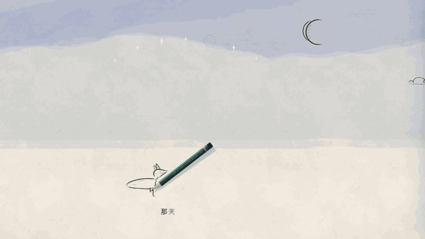
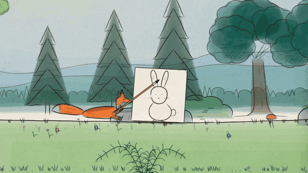
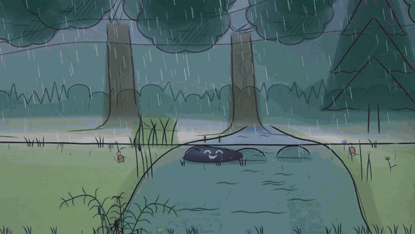
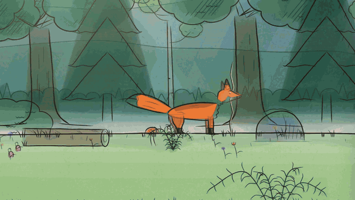
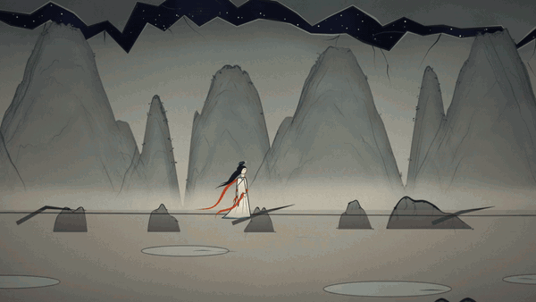
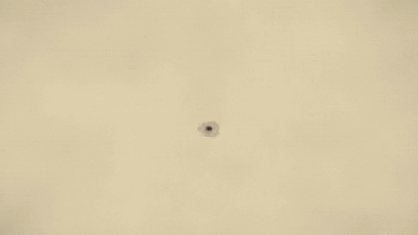
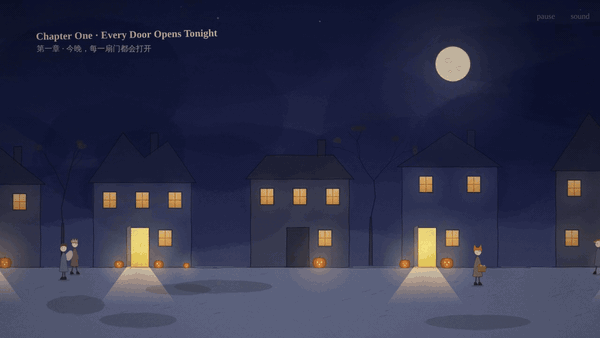

# hand-drawn-storybook-animation · 网页故事动画 Skill

A Claude Skill for making story-driven animations that are drawn live in the browser, in any 2D style: hand-drawn watercolor picture books, Chinese ink-wash myths, gongbi city scrolls with WebGL ink, cozy night-time picture books. It covers the whole pipeline: script (with a GPT write → critique → storyboard loop), designed camera shots, character animation, transitions, a generative score, Doubao (Volcengine) TTS narration and dialogue with bilingual subtitles, in-page screenshot / 15-second recording, vertical promo videos, and how to actually verify the result.

一个 Claude Skill：用代码在浏览器里实时画出来的故事动画，不限于手绘。做过四种风格：手绘水彩绘本、中国神话水墨、工笔水墨城市长卷（WebGL 流体墨）、夜晚绘本。覆盖完整流程：GPT 写剧本 → 自我批判 → 分镜图，镜头与运镜，角色表演，转场，实时生成的配乐，豆包语音配音与中英双语字幕，页面内截图和 15 秒录制，竖屏宣传片，以及怎么真正跑起来验证。

## Previews · 效果预览

Everything below is drawn live in the browser by code — no pre-rendered video, no image assets. Higher-quality MP4s are in [`previews/`](previews/).

下面的画面全部由代码在浏览器里实时画出来，没有预渲染视频，也没有图片素材。高清 MP4 在 [`previews/`](previews/) 里。

### 《追星星的小狐狸》The Living Storybook — 手绘水彩绘本

| | |
|---|---|
| **The page draws itself** 画面自己画出来<br> | **An ink blot comes alive** 墨滴活了过来<br> |
| **The giant ink shelter in the storm** 暴雨里的巨大墨怪<br> | **Through the torn page** 穿过撕开的纸页<br> |
| **Painting the star gold** 把金色还给星星<br> | |

### 更多风格 · More styles

| | |
|---|---|
| **《女娲补天》Nüwa Mends the Sky** 中国神话水墨：女娲托石、炼五色石、白描侧脸<br> | **《墨水宇宙 · 汴河码头》Along the River** 清明上河图：一滴墨晕成河，白描街市再淡设色<br> |
| **《今晚，有人敲门吗？》Who Knocks Tonight?** 万圣节夜晚绘本：暖灯冷月、灯笼河<br> | |

## Install · 安装

**Claude (claude.ai / desktop)**

1. Download this repo as a ZIP (or zip the `hand-drawn-storybook-animation` folder).
2. Customize → Skills → **+** → Create skill → **Upload a skill** → choose the ZIP.

**Claude Code**

```bash
git clone https://github.com/lhlGitHub/hand-drawn-storybook-animation-skill.git
cp -r hand-drawn-storybook-animation-skill/hand-drawn-storybook-animation ~/.claude/skills/
```

## Use · 使用

Just ask, for example:

- “做一本会自己画画的绘本，用豆包配音”
- “用水墨风格做一段女娲补天的动画”
- “做一段清明上河图风格的城市长卷，一滴墨晕开成河”
- “做一个万圣节夜晚的绘本动画，中英双语字幕”
- “把这部动画剪成 9:16 竖屏宣传片，配旁白和字幕”
- “Build a self-drawing storybook animation with bilingual subtitles”

Tip: write the script first with GPT in three rounds (write → critique → storyboard), then hand the script and storyboard to Claude with this skill.

小技巧：剧本先让 GPT 写三轮（写剧本 → 自我批判 → 出分镜图），再把剧本和分镜交给 Claude。

## Notes · 说明

- Doubao TTS needs your own Volcengine API key, kept in your project's `.env` — never commit it. If your cloud session can't reach the Doubao endpoint, run the TTS script on your own computer.
- 豆包配音需要你自己的火山引擎 API Key，放在自己项目的 `.env` 里，不要提交到仓库。云端会话连不上豆包时，在自己电脑上跑配音脚本。
